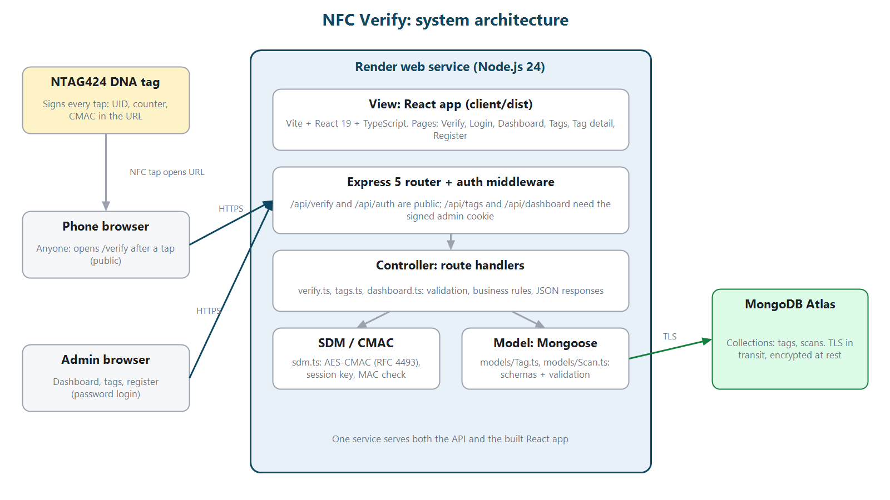
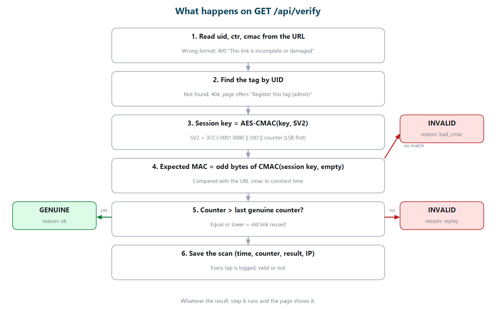
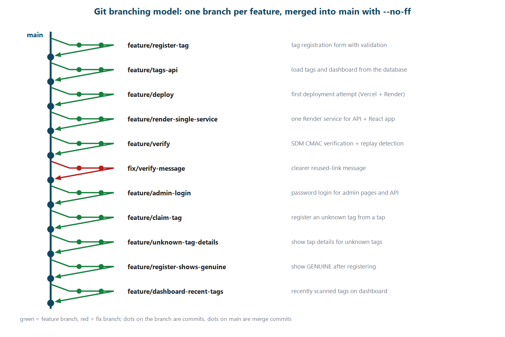

# NFC Verify

Tap a tagged item with any phone and see whether it is genuine. NFC Verify checks the cryptographic signature that an NXP NTAG 424 DNA tag produces on every tap, logs the scan and detects copied or reused links.

**Live demo:** https://nfc-verify.onrender.com (the free server sleeps when idle, so the first load can take up to a minute)

Course project for LUT CT70A9800 Full Stack Development · Hyechan Shin

## About

Each physical item is fitted with an NTAG 424 DNA NFC tag encoded with SDM (Secure Dynamic Messaging), so tapping it with any phone opens a URL containing the tag's UID, scan counter, and a cryptographic CMAC (Cipher-based Message Authentication Code). The backend validates the CMAC against a registered key, logs the scan (timestamp, counter, IP), and detects tampering or cloning attempts (a repeated or rolled-back counter). A public page shows the verification result (genuine/invalid) plus decoded tag details in both raw hex and human-readable form; an admin dashboard lets an owner register tags and review scan history.

**Definition of success:** a user can tap a real, encoded NTAG 424 tag with an unmodified phone browser and see an accurate genuine/invalid result within a couple of seconds, with the scan recorded and visible in the admin dashboard's history for that tag. **Status: met** (tested on iPhone and Android).

## Features

- **Public verify page** (`/verify`): GENUINE or INVALID, with UID, counter and CMAC in raw hex and readable form, plus recent scan history. No app or account needed.
- **CMAC check:** AES-128-CMAC (RFC 4493) and the SDM session-key derivation from NXP AN12196, implemented in [`server/sdm.ts`](server/sdm.ts) with Node's `crypto`.
- **Replay and clone detection:** a tap only counts as genuine if its counter is higher than the last genuine tap.
- **Scan log:** every tap is stored with time, counter, result, reason and IP.
- **Admin area (password login):** dashboard, tag list, tag detail with scan history, register and delete tags.
- **Register from a tap:** an unknown tag shows its tap details and a "Register this tag" button. The server only saves it if the key matches that tap's signature.

## Tech stack

| Part | Technology |
| --- | --- |
| Frontend | React 19, React Router 8, Vite 8, TypeScript |
| Backend | Node.js 24, Express 5, TypeScript, Mongoose 9 |
| Database | MongoDB Atlas |
| Hosting | Render (one web service for API and frontend) |

## Architecture



```
client/            React app (View)
  src/pages/       Verify, Login, Dashboard, Tags, TagDetail, RegisterTag
  src/api.ts       API calls and error handling
server/            Express API
  models/          Mongoose schemas: Tag, Scan (Model)
  routes/          verify, tags, dashboard handlers (Controller)
  sdm.ts           AES-CMAC + SDM MAC calculation
  auth.ts          admin login, session cookie, requireAdmin
  sdm.test.ts      unit tests
docs/              diagrams
```

In production Express serves the built React app from `client/dist` and the API under `/api`. In development Vite runs on port 5173 and forwards `/api` to Express on port 4000.

### How a tap is verified

The tag opens `https://nfc-verify.onrender.com/verify?uid=<UID>&ctr=<counter>&cmac=<MAC>`. The server:

1. derives a session key: `AES-CMAC(key, 3CC3 0001 0080 || UID || counter LSB-first)`
2. computes `AES-CMAC(session key, empty)` and keeps the odd-indexed bytes
3. compares that with the `cmac` in the URL (constant time)
4. checks the counter is higher than the last genuine tap, otherwise flags `replay`
5. logs the scan and returns the result



## API

| Method | Path | Access | Purpose |
| --- | --- | --- | --- |
| GET | `/api/health` | public | health check |
| GET | `/api/verify?uid&ctr&cmac` | public | verify and log a tap |
| POST | `/api/auth/login` · `/logout` | public | admin session |
| GET | `/api/auth/me` | public | is the visitor logged in? |
| GET | `/api/dashboard` | admin | totals and recently scanned tags |
| GET / POST | `/api/tags` | admin | list / register tags |
| GET / DELETE | `/api/tags/:uid` | admin | tag with scans / delete tag |

## Running locally

**Prerequisites:** Node.js 24, npm, and a MongoDB database (for example a free MongoDB Atlas cluster with your IP on the Network Access list).

```bash
git clone https://github.com/hyechanshin/nfc-verify.git
cd nfc-verify
```

Create `server/.env` (it is git-ignored):

| Variable | Description |
| --- | --- |
| `MONGO_URI` | MongoDB connection string |
| `ADMIN_PASSWORD` | password for the admin pages |
| `SESSION_SECRET` | long random string that signs admin session cookies |
| `PORT` | optional, default `4000` |

Start the server and the client in **two terminals**:

```bash
# terminal 1
cd server
npm install
npm run dev      # http://localhost:4000

# terminal 2
cd client
npm install
npm run dev      # http://localhost:5173
```

Run the tests:

```bash
cd server
npm test
```

Production build (what Render runs), from the repository root:

```bash
npm run build    # builds client/dist and server/dist
npm start        # app + API on http://localhost:4000
```

## Preparing a tag

Tags are configured once outside the app (browsers cannot write NTAG 424 settings), using GoToTags Desktop and an ACS ACR1552U reader:

- URL template: `https://nfc-verify.onrender.com/verify?uid=00000000000000&ctr=000000&cmac=0000000000000000`
- SDM with plain UID and read-counter mirroring and a MAC; offsets UID 42, counter 61, MAC 73, MAC input 73
- SDM file read key: key 0 (the factory default is all zeros; use a unique random key in real use)

Then tap the tag and press **Register this tag (admin)**.

## Deployment

One Render web service: root directory empty, build command `npm run build`, start command `npm start`, environment variables `MONGO_URI`, `ADMIN_PASSWORD`, `SESSION_SECRET` and `NODE_VERSION=24`. Every push to `main` deploys automatically.

## Git workflow



- `main` is always deployable.
- One branch per feature or fix (`feature/<name>`, `fix/<name>`), merged with `git merge --no-ff`.
- Commit messages follow [Conventional Commits](https://www.conventionalcommits.org/) (`feat:`, `fix:`, `chore:`).

## Security notes

- HTTPS to Render, TLS to MongoDB Atlas, Atlas encrypts data at rest.
- Secrets only in `.env` / Render environment variables.
- Admin session: httpOnly cookie signed with a separate `SESSION_SECRET`, constant-time comparisons, delayed response to wrong passwords.
- Rate limits per IP: 10 login attempts and 100 verify requests per 15 minutes.
- Security headers via `helmet` (content security policy, no framing, no MIME sniffing).
- Forged signatures (`bad_cmac`) are logged for the admin but hidden from the public history and never flag a tag, because anyone can send one for a known UID. A tag is flagged when a link with a valid signature but an old counter is used.
- Tag keys are never returned by the API. `npm audit` reports no known vulnerabilities.

**Planned** (from course feedback): encrypt SDM keys at rest with AES-256-GCM, store scan IPs as hashes, warn when a tag uses the factory-default key, and move route handlers into `server/controllers/`.
